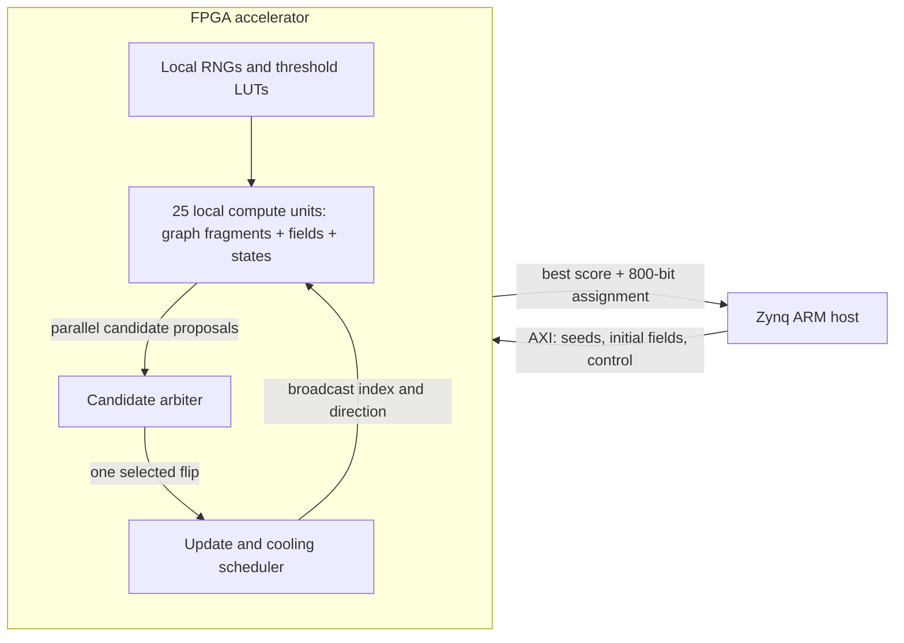

# Near-memory QUBO accelerator on Zynq-7020

An FPGA optimization engine that places graph storage next to parallel update
logic, reducing the movement of problem data during a search. This repository
contains the hardware implementation, software experiments, and results behind
**Design and FPGA Realization of QUBO Hardware Accelerator for MAX-CUT Problem**,
by **Maciej Lewandowski and Piotr Dudek**, presented at **IEEE ISCAS 2025**.

[Read the paper](paper.pdf) ·
[Project page and videos](https://mlewandowski0.github.io/ISCAS2025-FPGA-QUBO/) ·
[Reproduce the design](docs/reproduce.md) ·
[Validation and limitations](docs/validation.md)

## What this project demonstrates

The accelerator solves binary, unit-weight MAX-CUT instances, a concrete QUBO
application, on an **XC7Z020** FPGA. The original G15 configuration has
**800 variables**, divided into **25 compute units with 32 variables each**;
the maintained evaluation also demonstrates full graphs with **1000 and 2000 variables**.
Every unit stores its graph fragment and local state alongside its update
logic. Units evaluate candidates in parallel; an arbiter accepts one global
flip, and the units update their local fields in parallel.

The architectural focus is **near-memory computation**: partitioning the
problem, keeping frequently accessed data local, and broadcasting compact
update events. The underlying search algorithm is NeuroSA, whose origins are
neuromorphic. This is a synchronous digital FPGA implementation; the algorithm
and its original authors are credited below.

## My contribution

This repository is Maciej Lewandowski's FPGA implementation, developed in the
research project with Piotr Dudek at the University of Manchester. Its hardware
and implementation work includes:

- Mapping the NeuroSA update rule into a partitioned hardware architecture
  with local graph memories and parallel local-field updates.
- Implementing the RTL datapath, candidate selection, arbitration, update
  scheduling, and lookup-table-based stochastic thresholds.
- Exploring fixed-point arithmetic and hardware-friendly RNGs against Python
  simulations, including LFSR width and resource/solution-quality trade-offs.
- Integrating the accelerator with the Zynq processing system through
  AXI4-Lite, with host software for initialization and result collection.
- Evaluating G15 solution quality, FPGA resource use, and timing.

The public validation path adds deterministic input generation, independent
score checks, a fresh Vivado build, PYNQ deployment, and readable assignments.
These repository improvements are separate from the original paper results.

## How it works

For a graph with adjacency matrix `W`, the objective is to maximize the weight
of edges crossing a binary partition:

```text
C(x) = sum over edges (i,j) of W[i,j] * (x[i] + x[j] - 2*x[i]*x[j])
```

This is a QUBO objective. Internally the design uses spins `s[i]` in {-1,+1}
and local fields `h[i] = sum_j W[i,j] * s[j]`. Flipping spin `k` changes the
cut by `s[k] * h[k]`, and updates neighboring fields by
`h[j] <- h[j] - 2*s[k]*W[k,j]`, using the spin's value before the flip.
For binary edges the update requires conditional addition/subtraction rather
than a dense matrix multiplication.



The sealed G15 configuration uses fixed-priority selection, signed fixed-point
arithmetic, LFSR-generated noise, programmable cooling, and graph ROMs compiled
into the bitstream. Separate [Gset variants](docs/benchmarks.md) add runtime graph
loading and signed ±1 edges; the [Sudoku variant](docs/sudoku.md) adds clue
clamps and biased fields. Arbitrary weighted QUBOs remain unsupported.

## Results and evidence

The paper reports a G15 cut of **3049**, one below its reference value of 3050,
after approximately 75 million simulated clock cycles. The saved trace reaches
3049 at **75,516,185 cycles**. The paper's approximately **144 MHz** comes from
a reported **6.937 ns critical path**; the corresponding roughly 0.53 s is a
cycle-to-time estimate. It should not be read as a fresh board timing result.

| Evidence | What it establishes |
| --- | --- |
| [Paper](paper.pdf), Fig. 2, and [saved trace](paper_writing/current_best.txt) | Historical RTL simulation reaches 3049. |
| [Archive audit](results/archive/archive_groups.csv) | Recomputed summaries of every available recorded run, including incomplete/extra runs. |
| [Maintained RTL and tests](rtl/README.md) | A source-based simulation and board validation path with independently checked assignments. |
| [Validation report](docs/validation.md) | Actual rerun results, tool versions, hardware measurements, and outstanding limits. |

The archived Python logs do **not** unambiguously identify the exact 20-run
populations behind every entry in Table I. The later 2025 board implementation
also differs from the 2024 paper RTL. The validation report keeps these
experiments separate. Power numbers from Vivado are estimates; a board's power
supply rating is not a measurement of accelerator power.

The optimized design now **closes timing at 145.455 MHz** and runs on the
physical Zynq-7020 at **142.857143 MHz**, restoring the paper's clock range.
It reaches **3050** with the complete assignment read back and independently
verified. The optimized RTL replay preserves the earlier convergence trace,
including 3050 at cycle **7,395,076**, with seed 1 and a 65,536-cycle cooling period.

For a work budget of **100 million accepted flips**, the board measurements are:

| Configuration | Runtime, normalized to 100M flips | Best cut |
| --- | ---: | ---: |
| 50 MHz, seed 1 | 22.66 s | 3050 |
| 142.857 MHz, seed 1 | 7.93 s | 3050 |
| 142.857 MHz, seed 2 | 7.60 s | 3049 |
| 142.857 MHz, seed 3 | 7.33 s | 3049 |

The matched seed-1 throughput gain is **2.857×**. Median restored-clock
throughput is **13.165 million accepted flips/s**. Exact counts, polling
overshoot, hardware cycles, and verified assignments are retained in the
[performance results](results/performance/summary.json).

The [comparison audit](docs/comparison_audit.md) found incompatible work
counters in the old CPU/FPGA comparison. **The Intel and SpiNNaker2 speedup
claims are withdrawn.** The original timings remain documented for traceability;
a new matched-work or equal-quality comparison is needed. The measured 2.857×
figure above is FPGA clock scaling only.


## Beyond G15: verified Gset evaluation

**39 full graphs · 117 board runs · independently verified cuts.** The three
loadable-memory variants cover 37 of the 59 instances in the original
NeuroSA supplementary Tables S1/S2, plus G8/G9. They support signed 800-node
and unsigned 1000/2000-node graphs, at 100 MHz. Seeds 1–3 use exactly 10M
accepted flips and one fixed cooling schedule. Best-of-three quality reaches
at least 99% of the historical reference on every covered table entry.

[Full results and exclusions](docs/benchmarks.md) · [Raw summary](results/gset/summary.json).
The interactive demo includes the complete result table, a fresh named NumPy
CPU baseline, and first-hit timings at shared target cuts. The [SpiNNaker2 comparison](docs/spinnaker_comparison.md) locates its published
runtime bars in arXiv v2 and adds 90 FPGA trials at full reference-cut targets.
Different stopping rules are explicit; no matched FPGA/SpiNNaker2 speedup is claimed.


### Fixed native-iteration timing

A separate `ITR1` overlay stops at exactly **100 million arbitration
iterations**, counting both flip and no-flip decisions while excluding
update/drain cycles. On G4/G11/G15, three seeds give median active compute
runtimes of **1.289 / 2.597 / 2.284 seconds** respectively, with independently
verified cut ranges **11622–11641 / 562–564 / 3047–3050**. Up to 25 units
propose in parallel; native iterations are distinct from individual candidate
checks, accepted flips and clock cycles. [Definition and reproduction](docs/iterations.md).

## Watch the search

[**Open the interactive demo**](demo/index.html) after serving this folder:

```bash
python3 -m http.server 8000
# Open http://localhost:8000/demo/
```

The Sudoku viewer replays actual Zynq-7020 best assignments, with candidate
inspection, scrubbing, objective traces, and independent Sudoku checks. The paper's 24-clue puzzle also solves on the board with a slower cooling schedule;
the unsuccessful first attempt remains visible in Run details. It also
includes MAX-CUT playback and a separately labeled browser software solver.
The 729-bit Sudoku formulation follows [Mücke (2024)](https://arxiv.org/abs/2403.04816).
Clues reduce the classic example to 153 free bits; 71 unused physical slots
are disabled. This is a **separate, 100 MHz Sudoku overlay**, not the G15
performance configuration. [Demo guide](docs/demo.md) · [Sudoku implementation](docs/sudoku.md).

## Try it

Install Python/NumPy, Verilator, Make, and a C++ compiler, then run:

```bash
python3 -m pip install -r requirements.txt
make test
make sim
```

Simulation checks each accepted flip against a separate graph-based model and
recomputes the saved assignment's cut in Python. The AXI test exercises host
loading, independent write channels, byte strobes, response backpressure,
halt/resume, reset, and result readback.

With Vivado available, `make overlay` builds a fresh Zynq-7020 overlay targeting approximately 144 MHz.
The [reproduction guide](docs/reproduce.md) covers longer simulations, output
files, hardware deployment, seeds, and cooling settings. The
[register map](docs/registers.md) documents the PYNQ interface.

To check the committed 3050-cut assignment using only Python/NumPy:

```bash
python3 scripts/verify_saved_result.py results/rtl/summary.json
```

`make package` creates a source download and an overlay bundle without the
large historical project caches. See [publication notes](docs/publication.md).

## Repository map

| Path | Purpose |
| --- | --- |
| [`rtl/`](rtl/) | Maintained fixed-point implementation and explicit source manifest. |
| [`demo/`](demo/) | Buildless viewer of verified Sudoku and MAX-CUT trajectories. |
| [`sim/`](sim/) | Graph-based integration scoreboard and AXI testbench. |
| [`scripts/`](scripts/) | Input generation, simulation, archive audit, clean build, and board driver. |
| [`results/`](results/) | Recorded validation evidence and archive summaries. |
| [`paper.pdf`](paper.pdf) | Paper supplied with this repository. |
| [`ISCAS2025-FPGA-QUBO/`](ISCAS2025-FPGA-QUBO/) | Original project website and media. |
| [`diagrams/`](diagrams/) | Selected architecture figures and editable source. |
| [`python_code/`](python_code/) | Gset inputs and selected original code/logs used by the audits. |
| [`paper_writing/`](paper_writing/) | Selected historical convergence traces, logs, and analysis provenance. |
| [`zynq7020/`](zynq7020/), [`vitis_software/`](vitis_software/) | Only historical LUTs and source excerpts required by the maintained build/audit. |

Start with the [documentation guide](docs/README.md) or the
[results guide](results/README.md). Generated projects and unrelated experiments
have been removed from the current tracked tree. The original research archive
remains in Git history; on the development machine it is also preserved in an
ignored `.research-archive/` folder. This cleanup does not shrink Git history.
See [repository and release notes](docs/publication.md).

## Attribution and citation

The NeuroSA algorithm predates this FPGA work. The paper credits the 2024
Telluride Neuromorphic Cognition Engineering Workshop and Johannes Leugering
for the presentation and Python code that formed the implementation's
foundation. See the paper's acknowledgment and reference [14],
[ON-OFF Neuromorphic ISING Machines using Fowler-Nordheim Annealers](https://arxiv.org/abs/2406.05224).
The paper acknowledges UKRI support under grant EP/Y023048/1.

```bibtex
@inproceedings{lewandowski2025qubo,
  author = {Maciej Lewandowski and Piotr Dudek},
  title = {Design and FPGA Realization of QUBO Hardware Accelerator for MAX-CUT Problem},
  booktitle = {2025 IEEE International Symposium on Circuits and Systems (ISCAS)},
  year = {2025},
  url = {https://ieeexplore.ieee.org/document/11044179/}
}
```

The website template carries its own attribution and CC BY-SA 4.0 notice.
That notice does not establish a license for the RTL, original Python code,
benchmark data, or paper. No repository-wide software license is currently
specified; a license should be chosen with the relevant rights holders before
describing the whole repository as open source.
