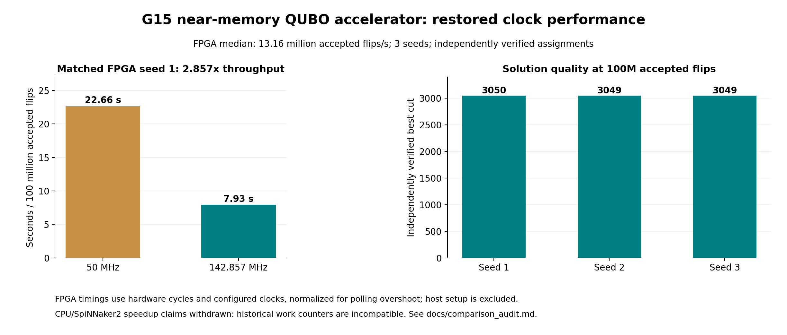

# Restored clock and performance comparison

The optimized accelerator closes timing at **145.455 MHz** and runs on the
supplied PYNQ board at **142.857143 MHz**. The slight difference reflects the
build-time PS clock model and the running board's PLL divisors. Both restore
the original approximately 140-144 MHz performance range.

The routed build has **+0.032 ns setup slack**, **+0.040 ns hold slack**, and
zero total negative slack. It uses **25,430 LUTs**, **14,243 registers**,
**7.5 BRAM tiles**, and **25 DSPs**. Reports and source hashes are retained in
[`results/implementation`](../results/implementation/).

## Direct hardware measurements

All runs use G15 (800 vertices, 4,661 binary edges), 25 units with 32 variables
per unit, fixed priority, 18-bit fixed point with 9 fractional bits, the same
LUTs, and 65,536 active cycles per cooling increment. The work budget is at
least **100 million accepted spin flips**. Each saved assignment is scored
independently against the graph. Every attempted final benchmark is retained.

| Clock | Seed | Seconds per 100M accepted flips | Best cut |
| --- | ---: | ---: | ---: |
| 50 MHz | 1 | 22.6605 | 3050 |
| 142.857 MHz | 1 | 7.9311 | 3050 |
| 142.857 MHz | 2 | 7.5961 | 3049 |
| 142.857 MHz | 3 | 7.3342 | 3049 |

The matched seed-1 throughput gain is **2.857×**. Across the three restored-clock
seeds, median throughput is **13.165 million accepted flips/s**, equivalent to
**7.596 seconds per 100 million accepted flips**. These are three measurements,
not a 20-run solution-success study.

Host polling stops slightly above the requested work budget. The raw JSON
files record the exact flip count, overshoot, active cycles, configured clock,
assignment, and all artifact hashes. The table normalizes measured hardware
time by `100,000,000 / actual_accepted_flips`. For example, seed 1 processed
100,101,202 flips in 1,134,167,509 cycles (7.9392 s), normalized to 7.9311 s.
Time excludes bitstream loading, host initialization, and result transfer.

[summary.json](../results/performance/summary.json) links every raw run.
Regenerate the summary with `python3 scripts/summarize_performance.py` and the
figure with `python3 scripts/plot_performance.py` (Matplotlib required).
The [reproduction guide](reproduce.md) gives board commands and timeout limits.

## Cross-platform comparison withdrawn

The old website numbers (504 s for Intel Core Ultra 9 185H, 2460 s for
SpiNNaker2, 20 s for FPGA) do not establish a controlled speedup. The original
software counts candidate rounds while the maintained FPGA counter counts
accepted state changes. A legacy FPGA counter also increments during waiting
cycles. Raw matched timing records were not supplied. These constants remain
only in the [comparison audit](comparison_audit.md) for traceability; no
CPU or SpiNNaker2 ratio is advertised.

The measured 2.857× result compares the same FPGA bitstream and seed at two
clocks. It is a throughput comparison, not a claim about time to a target
solution. The audit describes the event-budget and repeated-seed time-to-solution
protocols required before making a new cross-platform claim.

`hardware_seconds` uses counted active cycles and the actual configured clock.
For future board runs, `host_run_interval_seconds` captures the host enable-to-pause
interval immediately; it excludes loading, initialization, hashing and readout.
Older JSON files retain their original `seconds` field, which includes some
post-stop hashing and must not be used as end-to-end latency.
